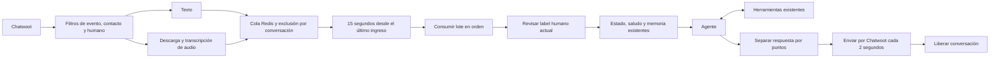

# Flujo principal F7 unificado

Fecha: 2026-11-03. Estado: **creado en n8n, inactivo; prueba de runtime pendiente**.

**Actualización 2026-11-04:** se aplicó el nuevo [system prompt según el brief](SYSTEM_PROMPT_F7_V1.md) y se conectó únicamente `enviar_multimedia`. Ahora tiene 63 nodos, timeout 780 s y bloqueo Redis 900 s; no inicia multimedia después de 210 s. `Leer Estado` obtiene el registro real de medios por conversación y el estado comercial viejo ya no se inyecta. Sigue inactivo; no hubo prueba de conversaciones contra el modelo. Las secciones siguientes documentan la construcción inicial del 03/11, incluidas las cinco herramientas y tiempos anteriores, no la configuración comercial nueva.

[Abrir el flujo](https://n8n.teotec.org/workflow/m7jZDzyP17BayLrI).

## Qué quedó armado

Un único webhook reúne entrada Chatwoot, filtros, audio, cola Redis, estado/memoria, agente y salida. Ya no llama a `Memory Manager - F7 v3` ni al workflow anterior del agente. Las cinco herramientas y `Log Mensaje` conservan sus IDs.

67 nodos totales: 60 de ejecución y 7 notas. El canvas está ordenado por etapas. Los nombres históricos se conservan donde permiten rastrear la procedencia.

## Cambios técnicos

- Se eliminaron el Execute Workflow que conectaba ambos flujos y el trigger de subworkflow del agente; las referencias ahora toman `Preparar Datos`.
- Se conserva el contrato `texto`, `key`, `telefono`, `conversation_id`. La memoria sigue usando el teléfono y los mismos credentials.
- Normalización del evento actual de Chatwoot: texto o audio sin caption; filtros de `message_created`, entrada pública de contacto, cuenta 1, identificadores y label `humano`. No se toma un adjunto de otro mensaje histórico de la conversación.
- Se reutilizaron únicamente las correcciones técnicas F1/F2/F7/F8/F9 preparadas en septiembre: SQL parametrizado, credential de salida, JSON.stringify, host del audio, label humano y registro de errores.
- Audio con binario explícito `data`, transcripción con el mismo credential OpenAI y timestamp consistente.
- El buffer usa el último ingreso, no el más viejo. GET + INCR permite que solo un consumidor pase; el lock cubre espera, consumo, agente y envío. Los demás esperan sin renovar el lock ocupado.
- Se consume el tamaño observado del lote mediante POP tail. No se borra la lista completa: mensajes nuevos quedan para el siguiente turno. Se deduplican IDs dentro del lote.
- Errores controlados del dueño liberan el lock y detienen la ejecución. Los perdedores no lo liberan. Timeout de workflow 300 s, TTL del lock 900 s; esperas cortas.
- La respuesta sigue separándose por puntos y conserva la limpieza anterior, pero ya no destruye puntos de importes, decimales, URLs o emails. El POST serializa JSON y conserva 2 s entre fragmentos.
- Las referencias a datos únicos usan `.first()` tras la agregación de múltiples items.

El prompt, el clasificador, las descripciones/contratos de las cinco herramientas, el modelo y los textos comerciales coinciden con n8n vivo. No se incorporaron las modificaciones comerciales F3–F6 del snapshot local ni el mapa conversacional propuesto.

## Aislamiento y credenciales

- Workflow nuevo: `m7jZDzyP17BayLrI`, `active: false`.
- Ruta preparada: `f7-principal-unificado-v1`.
- URL de producción preparada (todavía inactiva): `https://n8n.teotec.org/webhook/f7-principal-unificado-v1`.
- Buffer: `f7:unificado:v1:<account_id>:<conversation_id>:buffer`.
- Exclusión: `f7:unificado:v1:<account_id>:<conversation_id>:lock`.
- Se reutilizan referencias de Postgres, Redis, Chatwoot, OpenAI y Anthropic. No se crearon, editaron ni rotaron credenciales.
- Los nueve workflows anteriores, el webhook configurado en Chatwoot y las activaciones existentes no se modificaron.

## Verificación realizada

- `npm test`: **53 pasan, 4 TODO anteriores, 0 fallan**. Incluye 9 pruebas de lógica, 8 de grafo/contratos y 16 simulaciones de intercalados/límites del buffer. Los tests anteriores del clasificador siguen probando la versión local con Fase 0, no una ejecución del prompt vivo.
- Validador n8n sobre el archivo y sobre el workflow guardado: **0 errores, 0 conexiones inválidas**, 87 conexiones válidas, 71 expresiones revisadas. Queda una advertencia heurística de variable sin `$` en la función del normalizador; sus variables son parámetros/locales declarados.
- Relectura después de crear: parámetros, credentials, `onError`, `alwaysOutputData`, versiones, conexiones y settings coinciden. n8n agregó un webhookId interno al nuevo Wait, sin alterar su lógica.
- Export del nuevo workflow y `diff agente-principal-unificado`: **sin diferencias**.
- Diff de los nueve anteriores: solo las diferencias de Fase 0 ya conocidas en agente y Memory Manager. Las siete herramientas/servicios restantes siguen idénticos.
- Fuentes y backup: `docs/unificado-origen.json`, `backups/2026-11-03_165228-unificado/`. Los backups no se versionan ni comparten.

## Lo que todavía no está demostrado

No se ejecutó el workflow ni se enviaron mensajes a Chatwoot. Falta probar Redis, audio/transcripción, modelo, Postgres y entrega reales. El conector no tiene configurado el token del MCP oficial para la ejecución manual; el intento de usar la sesión de Chrome terminó porque Computer Use no pudo verificar la URL actual. No se continuó usando esa vía.

Las simulaciones no reemplazan runtime. Los límites del esquema nativo Redis quedan explícitos:

- INCR y EXPIRE son comandos separados en el [nodo Redis de n8n](https://raw.githubusercontent.com/n8n-io/n8n/master/packages/nodes-base/nodes/Redis/Redis.node.ts). Una caída entre ambos puede dejar un lock sin vencimiento; hay que verificar la operación en la versión instalada.
- Un fallo después de consumir el lote requiere recuperación desde la ejecución; liberar el lock no restaura mensajes. No hay reenvío automático porque podría duplicar una respuesta parcialmente enviada.
- Un timeout abrupto depende del TTL. Si los consumidores pendientes también terminaron, una cola puede necesitar un nuevo mensaje o intervención para continuar.
- Dedupe dentro del lote no equivale a entrega exactamente una vez entre lotes o ante una retransmisión tardía.
- El recheck de `humano` es antes del agente. El cambio humano durante herramientas/envíos no es atómico; las herramientas actuales conservan su comportamiento.

## Prueba pendiente y puesta en marcha

Según AGENTS.md, Mateo realiza la activación, el cambio del webhook de Chatwoot y el smoke-test desde su WhatsApp. Antes de migrar el tráfico hay que verificar con datos controlados:

1. Texto normal y tres mensajes seguidos: una respuesta al lote, 15 s después del último, orden intacto.
2. Audio con `content: null`, y audio seguido de texto: transcripción y una respuesta al conjunto.
3. Dos conversaciones concurrentes y un mensaje nuevo durante una respuesta: sin mezcla ni borrado del mensaje nuevo.
4. Evento outgoing, nota privada, evento actualizado y label `humano`: no responder. Comprobar el label agregado durante la espera.
5. Respuesta con `$20.000`, `3.14`, URL, comillas, apóstrofe y salto: JSON válido y fragmentos correctos.
6. Error controlado tras adquirir lock: queda ejecución con error y se libera; comprobar TTL, timeout y recuperación ante interrupción.
7. Revisar las cinco tools con el nuevo origen de `telefono` y `conversation_id`.

La base puede revisarse y continuar desarrollándose inactiva. No activar ambos circuitos sobre la misma conversación. No hubo commit ni push.

## Archivos

- `workflows/inactivos/agente-principal-unificado.json`: snapshot del nuevo workflow guardado.
- `src/unificado/construir.mjs`: composición inicial reproducible desde las fuentes vivas y los parches técnicos preparados.
- `src/unificado/logica.mjs`: funciones puras usadas por la normalización, evaluación del silencio y split.
- `scripts/preparar-unificado.mjs`: generador inicial; se niega a sobrescribir la base cuando ya tiene ID de n8n.
- `tests/unificado-*.test.mjs` y `tests/simulador-buffer-unificado.test.mjs`: verificación local.
