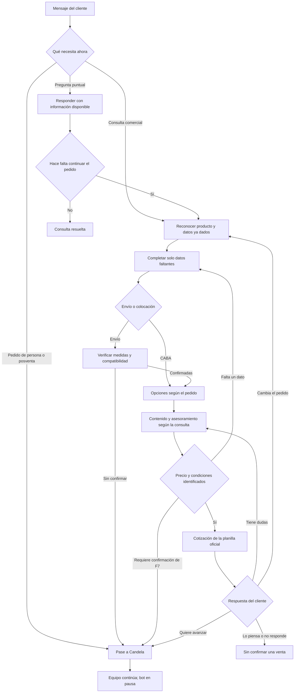

# Mapa conversacional F7 — versión 1 para revisar

Fecha: 2026-10-30. Pedido de Mateo: mostrar cómo pueden desarrollarse las conversaciones, sus preguntas y respuestas, usando el relevamiento nuevo y la planilla oficial.

**Esto es una propuesta de recorrido con simulaciones, no el comportamiento verificado del bot actual.** Las frases y bifurcaciones nuevas están para revisión; no se modificaron el prompt, las herramientas ni n8n.

## 1. Cómo leer los ejemplos

- **[T] Textual:** mensaje o fragmento literal del brief/respuestas del cliente. Se indica la fuente cuando corresponde.
- **[A] Adaptada:** redacción propuesta a partir de datos respaldados, incluidos importes oficiales. No está aprobada palabra por palabra.
- **[P] Propuesta:** frase de enlace, repregunta o salida para un caso sin texto definido. Su aplicación comercial necesita aprobación antes de implementarse.
- **[D] Dato pendiente:** condición necesaria para responder que todavía no está confirmada. La conversación muestra cómo evitar inventarla.
- **Acción interna:** contenido que se envía, comprobación o pase al equipo; no es un mensaje escrito por el bot ni una acción ejecutada durante este análisis.

Los clientes y conversaciones son ficticios. “F7” representa la respuesta del sistema; no implica que el bot deba presentarse como Candela. Se conserva la separación actual: las herramientas envían contenido, cotizaciones y derivaciones, y el agente agrega la frase corta correspondiente. Este documento no redistribuye esos textos entre componentes.

Definiciones de Mateo ya incorporadas: el bot asesora, muestra contenido, cotiza y detecta intención de avanzar; Candela continúa cierre, pago y armado del pedido. No se exige elegir diseño, entregar datos personales ni pagar para poder hablar con Candela. Si el cliente ya expresó preferencias, se conservan para el pase.

## 2. Vista general

Las rutas de posventa, pedido de persona, confirmación faltante y pausa humana son propuestas operativas coherentes con el alcance; su frase y disparador preciso se revisan en este mapa. Una FAQ puede interrumpir cualquier etapa: se responde y se retoma desde los datos ya conocidos. Si la consulta queda satisfecha, no hace falta forzar una venta.

### Datos para decidir el siguiente paso

| Dato | Cuándo hace falta | Ejemplo de pregunta [P] |
|---|---|---|
| Producto o necesidad | Si el primer mensaje no lo deja claro. | “Te gustaría recibir información de algun articulo en especial o quisieras conocer cuales son nuestros productos?” [T, brief §3]. |
| Modalidad | Antes de una oferta/cotización que depende de envío o CABA. | “Hacemos envios a todo el pais y nuestro taller esta situado en CABA. Quisieras la opción de envio o colocarlo en nuestro taller?” [T, §1]. |
| Vehículo y año/variante | Para encontrar el producto y la fila correcta. | “Para qué vehículo y año sería?” |
| Configuración | Cuando hay varios precios por plazas, asientos, habitáculo/baúl o pieza. | “Buscás el juego completo o solo los dos asientos delanteros?” |
| Medidas/compatibilidad | Antes de ofrecer confección por envío. Es una comprobación del negocio. | Si no se puede verificar: “Voy a pasarle tu consulta a Candela para confirmar qué opción podemos ofrecerte para ese modelo.” |
| Medio de pago | Se usa si el cliente lo pide; no hace falta preguntarlo para mostrar los valores aplicables. | “Para colocación en CABA, el valor es ... en efectivo o ... por transferencia.” [A]. |
| Diseño y color | Para asesorar si el cliente quiere; no bloquea precio base ni pase a Candela. | “Preferís algo discreto o que combine con el interior o el exterior del vehículo?” [A, §9]. |

Si el cliente ya dice “Cronos 2022, juego completo tipo tapizado, para colocar en CABA”, no se le vuelven a preguntar esos datos. Si llega desde una publicidad, se usan únicamente los datos de origen que efectivamente estén disponibles; no se adivina el vehículo.

## 3. Opciones que se pueden presentar

| Situación | Recorrido respaldado | Límite |
|---|---|---|
| Fundas para colocar en CABA | A medida, tipo tapizado y tapicería; explicar diferencias sin desmerecer una opción. | No prometer turno ni disponibilidad inmediata. |
| Fundas para envío, medidas de ambas confirmadas | Ofrecer a medida y tipo tapizado. | Un precio cargado no equivale a medidas confirmadas. |
| Envío, solo medidas de a medida confirmadas | Ofrecer a medida; video y pregunta sobre diseño/valor. | No presentar tipo tapizado como disponible. |
| Envío, medidas sin confirmar | Confirmar con el equipo antes de prometer confección. | No concluir que a medida es posible solo porque tipo tapizado no lo es. |
| Alfombra o cubrevolante pedido expresamente | Atender ese producto; consultar la variante necesaria. | No obligar a recorrer la venta de fundas. |
| Tapicería, paneles, relleno o techo | Atención para trabajo en CABA; evaluación o coordinación con el equipo según el pedido. | No ofrecer envío del trabajo ni tratar todos los trabajos como equivalentes a un precio de la hoja. |
| Baúl, cobertores o espumas | Identificar producto/variante/pieza y precio si corresponde. | La existencia de una hoja no implica aprobación de toda su venta automática. |

## 4. Conversaciones posibles

### C01. Consulta general → fundas a medida en CABA → Candela

**Cliente:** Hola, quería información.

**F7 [A]:** Buen dia! Como estas?

**F7 [T]:** Te gustaría recibir información de algun articulo en especial o quisieras conocer cuales son nuestros productos?

**Cliente:** Fundas para mi Logan 2022.

**F7 [T, §1]:** Cada funda se realiza a medida y por encargo para cada butaca , el material que utilizamos es cuero automotor. Podes elegir diseño y color que te guste

**F7 [T]:** Hacemos envios a todo el pais y nuestro taller esta situado en CABA. Quisieras la opción de envio o colocarlo en nuestro taller?

**Cliente:** Lo llevaría al taller.

**F7 [A]:** Para colocar en CABA podemos ofrecerte fundas a medida, fundas tipo tapizado y trabajos de tapicería.

**Acción interna:** enviar el video que muestra la diferencia entre las dos fundas. La tapicería se explica como trabajo sobre el tapizado del vehículo; no se usa ese video para afirmar que demuestra las tres opciones.

**F7 [T, §3]:** Cuál de las opciones se adapta a lo que estabas buscando?

**Cliente:** Las fundas a medida, el juego completo de 5 plazas.

**F7 [A, precio S1]:** El juego completo de fundas a medida para tu Logan tiene un valor de $353.000 en efectivo o $427.350 por transferencia. Incluye colocación en CABA. Podés elegir el diseño y color que te guste.

**Acción interna:** enviar catálogo de diseños: https://wa.me/c/5491156013327.

**F7 [T, §5]:** Quisieras visitarnos para conocer la calidad del trabajo que realizamos o preferís encargarlo por transferencia?

**Cliente:** Quiero encargarlo por transferencia. Me gusta negro con costura gris.

**F7 [P]:** Perfecto! Te paso con Candela para continuar con el encargo. Le dejo anotado que te interesa negro con costura gris.

**Resultado propuesto:** derivación con vehículo, año, 5 plazas, producto, CABA, $427.350 por transferencia, contenido enviado y preferencia de color. No afirmar que el pedido quedó confirmado, señado o en confección. No pedir alias, comprobante ni fotos desde el bot.

### C02. El cliente ya sabe qué quiere → precio directo → plazo

**Cliente:** Cuánto sale el juego completo de tipo tapizado para un Cronos 2022? Lo llevo a CABA y pagaría por transferencia.

**F7 [A, S2]:** El juego completo de fundas tipo tapizado para tu Cronos tiene un valor de $665.500 por transferencia, con colocación en CABA incluida.

**F7 [P]:** Quisieras avanzar con esta opción?

**Cliente:** Cuánto tardan?

**F7 [T, §5]:** El tiempo de confección es de 7 días hábiles aproximadamente a partir de la seña. Una vez confeccionadas nos comunicamos con vos para coordinar la colocación , en este etapa tardamos un dia laboral ( de 9 a 18 usualmente)

**Cliente:** Dale, quiero hacerlo.

**F7 [P]:** Perfecto! Te paso con Candela para continuar con el encargo.

**Criterio propuesto:** aprovechar todos los datos iniciales y no forzar catálogo, elección de diseño ni repetición de modalidad. El medio de pago informado no equivale por sí solo a intención de compra: el pase ocurre al decir “quiero hacerlo”. El orden de respuesta directa constituye una propuesta comercial para aprobar.

### C03. Envío, solo fundas a medida confirmadas → diseño o valor

**Supuesto de la simulación:** F7 ya confirmó medidas de a medida para el vehículo; no confirmó tipo tapizado. No se afirma que ese dato esté disponible hoy en una base consultable.

**Cliente:** Quiero fundas para un Logan 2022, sería envío a Córdoba.

**F7 [T]:** Cada funda se realiza a medida y por encargo para cada butaca , el material que utilizamos es cuero automotor. Podes elegir diseño y color que te guste

**F7 [A]:** Para tu vehículo, la opción que tenemos confirmada para envío es la funda a medida.

**Acción interna:** enviar video de fundas a medida.

**F7 [T, §3]:** Quisieras elegir el diseño o simplemente saber su valor?

**Cliente:** Primero el valor.

**F7 [P]:** Buscás el juego completo de 5 plazas?

**Cliente:** Sí, y pagaría por transferencia.

**Dato de control [D]:** la planilla oficial se titula CABA; la regla previa de precio de crédito y descuento de envío no debe imponerse sobre sus encabezados. Antes de prometer una cotización de envío, debe quedar establecido qué celda oficial se aplica a esa modalidad. No se inventa un segundo descuento ni se trata transferencia como crédito.

**Si esa correspondencia está validada [A]:** El juego completo de fundas a medida para tu Logan tiene un valor de {importe oficial aplicable a envío} por transferencia, en el diseño y color que elijas.

**Si todavía no está validada [P]:** Te paso con Candela para confirmar la cotización para envío de tu juego completo.

**Si pidió diseños:** enviar catálogo y orientar la elección antes de retomar la cotización. La duda pendiente limita el precio concreto, no impide mostrar el resto de la conversación.

### C04. Envío con dos opciones habilitadas → diferenciación

**Supuesto:** medidas de ambas opciones y compatibilidad confirmadas por F7 para el vehículo consultado.

**Cliente:** Para envío, qué diferencia hay entre las dos fundas?

**F7 [A]:** Te muestro un video donde podés ver cómo están confeccionadas las fundas a medida y las tipo tapizado.

**Acción interna:** enviar el video de diferenciación. El brief pide mostrar esta diferencia con video; no pegar automáticamente su transcripción extensa.

**F7 [T]:** Cuál de las opciones se adapta a lo que estabas buscando?

**Cliente:** La que también viene en cuero por atrás.

**F7 [A]:** Esa es la funda tipo tapizado. Puede respetar el diseño original o hacerse con el diseño que elijas.

**Cliente:** Quiero el diseño original.

**Resultado:** conservar `tipo tapizado` y preferencia `original`; obtener la cotización aplicable sin volver a fundas a medida por haber elegido un diseño. Si falta la regla de envío, usar la salida de C03. Si el cliente quiere avanzar, pase a Candela sin exigir fotos al bot.

### C05. Modelo ambiguo → aclaración puntual

**Cliente:** Cuánto salen las alfombras para una Berlingo?

**F7 [P]:** De qué año es y es furgón de cabina simple o la versión de pasajeros?

**Cliente:** 2018, furgón de cabina simple. Las busco para CABA.

**F7 [T, §1]:** Las alfombras termoformadas cubren por completo el piso de tu vehículo, evitando derrames o futuros daños

**F7 [A, S3]:** Para la Berlingo furgón de cabina simple 2005 en adelante, la planilla indica $276.000 en efectivo o $333.960 por transferencia.

**Cliente:** Quiero esas.

**F7 [P]:** Perfecto! Te paso con Candela para confirmar disponibilidad y coordinar el pedido.

**Límite:** se informa precio, no stock confirmado. No usar los $319.900/$387.079 de la fila Berlingo general para la variante furgón. No prometer un envío o instalación automática porque haya una fila de precio.

### C06. Cubrevolante suelto → cotización → turno humano

**Cliente:** Quiero solo un cubrevolante para mi Cronos. Lo colocan en CABA?

**F7 [A]:** Sí, la colocación en CABA se coordina con turno previo. El cubrevolante es cosido a mano.

**Acción interna:** enviar contenido de cubrevolante si corresponde a la consulta; no enviar catálogo de fundas.

**F7 [A, S4]:** El valor es $60.000 en efectivo, $72.600 por transferencia o $79.134 por POSNET o cuotas.

**Cliente:** Puedo ir mañana?

**F7 [P]:** Te paso con Candela para que confirme la disponibilidad y coordinen el turno.

**Límite:** $79.134 es el total de la columna POSNET/cuotas; no es una cuota. El bot no reserva ni afirma disponibilidad para mañana. El brief ya establece derivación para un producto suelto que requiere turno.

### C07. Varias cosas → cotización separada → quitar un producto

**Contexto:** se cotizó el juego de fundas a medida del Logan en CABA por transferencia, como en C01.

**Cliente:** Sumale el cubrevolante y alfombras.

**F7 [P]:** Dale! Mantengo las fundas y reviso los otros dos productos para tu Logan.

**Acción interna:** conservar vehículo, modalidad y medio de pago; verificar variante de alfombra, precios y disponibilidad por separado. No enviar contenido de fundas otra vez por agregar accesorios.

**Cliente:** No, las alfombras no. Solo fundas y cubrevolante.

**F7 [A, S1+S4]:** Quedarían las fundas a medida por $427.350 y el cubrevolante por $72.600, ambos por transferencia. La suma es $499.950.

**F7 [P]:** Querés avanzar con esos dos productos?

**Cliente:** Sí.

**F7 [P]:** Perfecto! Te paso con Candela para continuar con el encargo de las fundas y el cubrevolante.

**Límite:** suma aritmética de dos precios oficiales, sin descuento de combo supuesto. Las alfombras se quitan del pedido propuesto. “No quiero avanzar” debe frenar el pase; el “no” de “alfombras no” solo modifica ese producto.

### C08. Cambia de producto después del catálogo

**Cliente:** Me gusta el diseño diamante, pero lo quiero en tipo tapizado.

**F7 [P]:** Perfecto, seguimos con tipo tapizado y dejo anotado el diseño diamante. Reviso el valor para esa opción.

**Acción interna:** mantener vehículo, modalidad y diseño; seleccionar fila de tipo tapizado y verificar condiciones correspondientes. No reutilizar la cotización de fundas a medida.

**Si el cliente solo dice “me gusta ese”:** interpretar como preferencia sobre el contenido que está mirando; no como confirmación de pago, compra o pase a humano sin más contexto.

### C09. Precio caro → respuesta de F7 → límite

**Contexto:** fundas con colocación en CABA, precio ya informado.

**Cliente:** Me parece caro, en otro lugar me pasaron menos.

**F7 [T, §6]:** Te entiendo perfectamente! Con nuestros trabajos priorizamos la calidad protegiendo y renovando tus butacas con un material resistente y duradero, garantizando que tus fundas queden bien ajustadas , sin que las fundas corran ni se muevan.

**F7 [T, continuación]:** Además, contas con una garantía de 90 días desde la colocación para brindarte tranquilidad con el trabajo realizado.

**F7 [T, continuación]:** ¿Estas buscando una opción económica o realizar una inversión que dure en el tiempo?

**Cliente:** Igual se me va de presupuesto.

**F7 [T, §6]:** Te entiendo! Como te mencionaba anteriormente el valor es en base al servicio que ofrecemos incluyendo su colocación y como quedan colocadas, evitando que se muevan o se corran

**Cliente:** Lo voy a pensar.

**F7 [P]:** Dale, quedo a disposición si te surge alguna consulta.

**Criterio propuesto:** cerrar amablemente sin inventar descuento, presionar ni insistir con una tercera objeción. La segunda frase menciona colocación; no trasladarla automáticamente a una cotización solo por envío. La frase textual se conserva aunque luego Mateo decida revisarla; no se suaviza silenciosamente.

### C10. Quiere avanzar, pero no eligió diseño

**Cliente:** Me sirve el precio. Quiero encargarlo, pero todavía no sé el color.

**F7 [P]:** Perfecto! Te paso con Candela para continuar con el encargo y definir el diseño y color.

**Acción interna:** registrar interés explícito, producto y precio; diseño/color pendientes. No pedirle que complete el catálogo para habilitar el pase.

**Variante si todavía quiere asesoramiento del bot [A, §9]:** Preferís algo discreto, en negro o gris, o que combine con el interior o exterior del vehículo?

**Criterio propuesto:** acompañar la elección cuando la pide, sin convertirla en requisito del cierre humano.

### C11. No están confirmadas las medidas o falta precio

**Cliente:** Me mandan tipo tapizado para mi modelo? No lo vi en la lista.

**F7 [P]:** Decime el modelo y año del vehículo así reviso la opción que corresponde.

**Cliente:** {vehículo y año}.

**Acción interna:** comprobar por separado medidas, compatibilidad y precio. El ejemplo se detiene porque uno de esos datos no está confirmado.

**F7 [P]:** Te paso con Candela para confirmar qué podemos ofrecerte para ese modelo.

**Límite:** “sin dato” no significa “no lo hacemos”, “sin stock”, “sale cero” ni “podemos mandarlo igual”. No prometer toma de medidas en 30 minutos ni viaje a CABA como salida por defecto: esa bifurcación histórica no quedó aprobada con el relevamiento nuevo.

### C12. Consulta que no se atiende: moto

**Cliente:** Hacen trabajos para una moto?

**F7 [T, §6 y cierre/Preguntas finales]:** Gracias por tu interes en nuestros productos, actualmente no realizamos trabajos de tapiceria para motos

**Resultado:** respuesta directa. No ofrecer automáticamente fundas de auto, cotizar por parecido ni insistir.

### C13. Reclamo, comprobante o pedido de una persona

**Cliente:** Me llegó distinto de lo que elegí.

**F7 [P]:** Lamento lo que pasó. Te paso con Candela para que revise tu pedido y pueda ayudarte.

**Variante — Cliente:** Ya hice la transferencia, te mando el comprobante.

**F7 [P]:** Te paso con Candela para que revise el comprobante y continúe con tu pedido.

**Variante — Cliente:** Quiero hablar con una persona.

**F7 [P]:** Te paso con Candela para que pueda ayudarte.

**Acción interna:** preservar lo recibido y derivar. Solo decir “recibí el comprobante/la foto” si el sistema efectivamente recibió ese adjunto. No declarar pago validado, pedido señado, devolución rechazada, compensación aprobada ni confección iniciada.

**Límite:** el reclamo del brief contiene circunstancias de otro caso; no se reutilizan sus nombres, importes, afirmaciones sobre la boleta ni propuesta de envíos bonificados como respuesta universal. El pase por reclamo y su frase son propuesta de esta versión, no política comercial nueva ya desplegada.

### C14. Tapicería completa en CABA

**Rama propuesta de alcance:** cotizar el trabajo identificado en la hoja de tapicería, sujeto a que esa categoría se habilite en el nuevo agente; no extender ese precio a una reparación de pieza.

**Cliente:** Quiero hacer tapicería completa para las cinco plazas de un Logan 2022. Lo llevaría al taller de CABA.

**F7 [A, S5]:** Para las 5 plazas del Logan, la hoja de tapicería indica $690.000 en efectivo o $834.900 por transferencia.

**Cliente:** Cuánto tiempo queda el auto?

**F7 [T, fragmento §5]:** El proceso de confección y colocación es de 1 dia y medio aproximadamente desde que tu vehículo llega a nuestro taller .

**Cliente:** Dale, quiero coordinarlo.

**F7 [P]:** Te paso con Candela para revisar el trabajo y coordinar el ingreso al taller.

**Límite:** el precio depende del alcance exacto del trabajo y no reserva un turno. Si en cambio pide cambiar un panel, rellenar una butaca o reparar cuero, se identifica ese pedido y se usa la consulta correspondiente; no se aplica automáticamente la tarifa de las cinco plazas.

### C15. Consulta por una pieza o categoría adicional

**Cliente:** Necesito espuma para la butaca de un Clio.

**F7 [P]:** Qué versión es y necesitás la parte del asiento o el respaldo?

**Cliente:** Clio 2, el asiento. Necesito que lo hagan ustedes.

**F7 [A]:** Ese trabajo se realiza en nuestro taller de CABA.

**F7 [P]:** Te paso con Candela para confirmar el trabajo que necesitás y coordinarlo.

**Acción interna:** distinguir repuesto de espuma, agregado de espuma y trabajo de relleno antes de seleccionar precio. No tratar todas las menciones de “espuma” como el mismo rubro.

**Variante — cobertor de caja [P]:** “Para qué vehículo y versión sería? Es furgón o de pasajeros?” Solo preguntar las diferencias que cambien la fila del modelo consultado; no extender un precio sin modelo a toda una marca.

**Variante — funda de baúl [P]:** “Para qué modelo, año y carrocería lo necesitás?” Seleccionar una coincidencia segura y verificar modalidad/alcance antes de cotizar. La habilitación de cotización automática de estas categorías sigue siendo propuesta.

## 5. Preguntas que pueden aparecer en cualquier etapa

Las respuestas [A]/[P] de esta tabla son propuestas de redacción para revisar. Las [T] reproducen el material. Se responde la consulta concreta y se conserva el estado previo de la conversación.

| Pregunta del cliente | Respuesta posible de F7 | Base / límite |
|---|---|---|
| ¿Dónde están? | [T] “📍La dirección es Av. Olivera 1265 , CABA.” | Brief §5. No pedir modelo para responder una dirección. |
| ¿Qué horarios tienen? | [T] “Te esperamos de lunes a viernes de 9 a 18 hs y sábado de 9 a 14 hs” | Brief §5; no confirma turnos libres. |
| ¿Me pasás la ubicación? | [T] “Nuestra ubicación exacta la podes ver ingresando a este link https://maps.app.goo.gl/Nsyib1THu4WCN2L8A?g_st=ipc” | Brief §5. |
| ¿Son a medida? ¿Qué material usan? | [T] “Cada funda se realiza a medida y por encargo para cada butaca , el material que utilizamos es cuero automotor. Podes elegir diseño y color que te guste” | Brief §1; no agregar composición química ni prestaciones no declaradas. |
| ¿Qué diferencia hay entre a medida y tipo tapizado? | [A] “Te muestro un video donde podés ver cómo están confeccionadas las dos opciones.” + envío del video. | Brief §1: explicar principalmente mediante video. No presentar una como inferior. |
| ¿Y si quiero tapicería? | [A] “Los trabajos de tapicería se realizan en nuestro taller de CABA. Contame qué parte querés trabajar.” | Brief §§1–2. Confirmar pieza/trabajo antes de adjudicar un precio de otra categoría. |
| ¿Puedo elegir diseño y color? | [T, fragmento] “Podes elegir diseño y color que te guste” + catálogo. | Brief §1. No exigir elección para consultar precio base. |
| ¿Me ayudás a elegir el color? | [A] “Preferís algo discreto, en negro o gris, o que combine con el interior o exterior del vehículo?” | Basada en §9. Guardar preferencia sin declararla confirmación final. |
| ¿Qué cuesta agregar un logo? | [A] “En la hoja de fundas a medida figura un adicional de $10.000 por logo.” | S1, L1. No generalizar a otras categorías ni inventar tratamiento por pago. |
| ¿Cuánto tardan las fundas a medida? | [A] “La confección lleva aproximadamente 5 días hábiles desde la seña. Una vez listas, coordinamos la colocación, que lleva entre 4 y 5 horas.” | Brief §5, CABA. Para envío, separar confección de tránsito; no dar fecha de entrega sin datos. |
| ¿Cuánto tarda tipo tapizado? | [A] “La confección lleva aproximadamente 7 días hábiles desde la seña. La colocación ocupa un día laboral, usualmente de 9 a 18.” | Brief §5. No prometer día exacto. |
| ¿Cuánto tarda un trabajo de tapicería? | [A] “La confección y colocación llevan aproximadamente un día y medio desde que el vehículo llega al taller.” | Brief §5. No decir que ese plazo empieza al pagar la seña. |
| ¿Tiene garantía? | [T, para fundas] “Contas con garantía de fábrica por 90 días desde su colocación” | Brief §5. Para tapicería: [A] “Los trabajos de tapicería tienen 6 meses de garantía de fábrica.” No extender esos plazos a accesorios sin fuente. |
| ¿Hacen envíos? | [A] “Sí, hacemos envíos a todo el país. Contame qué producto y para qué vehículo necesitás.” | Brief §§1–2. Si esos datos ya están, omitir la pregunta. No equivale a compatibilidad de cualquier producto. |
| ¿Cuánto cuesta el envío? | [A] “En fundas, el envío usualmente está bonificado. Si pedís un accesorio suelto, como alfombras o cubrevolante, lo abonás al recibirlo.” | Brief §5 y cierre/Preguntas finales. No convertir “usualmente” en garantía para todo pedido ni calcular un flete no informado. |
| ¿Por qué empresa mandan? | [P] “Candela te puede confirmar el transporte para tu pedido.” | [D] No está identificado el transportista. No inventar Correo Argentino, Andreani u otro. |
| ¿Cuánto tardaría en llegar a mi ciudad? | [P] “Candela te confirma el plazo de envío para tu localidad.” | [D] No confundir días de confección con tránsito ni prometer fecha. |
| ¿Lo puedo colocar yo? | [A, si la opción de envío está confirmada] “Te enviamos un video para la colocación.” | Brief §8. No inventar duración, herramientas necesarias ni garantía de facilidad. |
| ¿Hay colocación en Bariloche? | [A] “Hay una persona que realiza colocaciones en Bariloche. Te paso con Candela para confirmar la coordinación de tu pedido.” | Brief §8. No inventar dirección, tarifa o turno. |
| ¿Y en Villa la Angostura o El Bolsón? | [P] “Te paso con Candela para confirmar la opción de colocación en tu localidad.” | [D] Cobertura local no confirmada; no equiparar automáticamente a Bariloche. |
| ¿Incluye colocación? | [A, fundas en CABA] “Sí, el precio informado para colocación en CABA la incluye.” | Brief §1. No trasladarlo automáticamente a envío o a una pieza/rubro distinto. |
| ¿Puedo pagar en efectivo? | [A] “Para colocación en CABA tenemos precio en efectivo. Para tu pedido es de {celda oficial}.” | Brief §3 y hoja aplicable. No ofrecer efectivo a distancia por defecto. |
| ¿Puedo pagar en cuotas? | [T] “También podes abonar en *3 cuotas sin interés  los días miércoles y sábado*” | Frase respaldada por brief §6 y cierre 6.3. Debe aplicarse al producto/condición correspondientes; no deducir el total de cuotas del precio de transferencia de fundas. |
| ¿De cuánto sería cada cuota de las fundas? | [P] “Candela te confirma el importe de las cuotas para ese trabajo.” | [D] La muestra de fundas tiene efectivo/transferencia, sin precio de tarjeta separado. No calcular transferencia ÷ 3 por suposición. |
| ¿Cuánto tengo que señar? | [A] “Para fundas a medida, la referencia informada es entre $50.000 y $60.000; para tipo tapizado y tapicería, desde $100.000. Candela te confirma el importe para tu pedido.” | Brief §4. La planilla consultada no aporta una seña distinta. No convertir rangos en importes exactos ni enviar alias. |
| ¿Cuándo pago el saldo? | [A] “Si es con envío, el saldo se abona antes de despachar. Para colocación en CABA, se completa el día del turno.” | Brief §4. El equipo confirma el momento exacto en CABA. |
| ¿Pueden hacerlo sin seña? | [T] “El trabajo que realizamos se realiza a medida y de manera personalizada, por lo tanto se requiere una seña para encargar tu trabajo y que podamos comenzar a confeccionarlo” | Brief §6. Si insiste, propuesta: pase a Candela; no conceder excepción. |
| Me da desconfianza señar sin verlo. | [T] “Entiendo que antes de señar quieras estar seguro del trabajo que vas a realizar” + [T] “Si te sirve para conocer un poco más sobre nuestra forma de trabajar, podés mirar las opiniones de Google Maps de clientes que ya nos eligieron. Ingresando al siguiente link vas a encontrar referencias reales de otros clientes.” + https://maps.app.goo.gl/GXM9UNNfXhj7EpYi7?g_st=ic | Brief §6. Si quiere visitar CABA, informar ubicación; si persiste la duda, salida humana propuesta, sin presionar. |
| ¿Me hacés un descuento? ¿Y por llevar dos cosas? | [P] “Te puedo informar los valores de la lista vigente. Para revisar una condición especial, te paso con Candela.” | No hay descuento de combo autorizado en las fuentes. |
| ¿La funda más económica es de menor calidad? | [A] “Las opciones tienen distintas formas de confección y terminación. Te muestro el video para que puedas elegir la que se adapta a lo que buscás.” | Brief §8 prohíbe desmerecer productos y comparar por inferioridad. No repetir la premisa. |
| ¿Reparan el cuero roto? | [A] “No hacemos reparación de cuero. Podemos evaluar un trabajo de tapicería para cambiar la pieza completa en el taller de CABA.” | Brief §2. No prometer presupuesto sin identificar el trabajo. |
| ¿Trabajan con camiones o utilitarios? | [A] “Sí, también trabajamos con camiones, minivans, vehículos de traslado, camionetas, furgonetas y utilitarios. Decime el modelo y qué asientos querés cubrir.” | Brief §2. Compatibilidad concreta y modalidad se verifican después. |
| ¿Afecta los airbags? ¿Es compatible con mi butaca especial? | [P] “Te paso con Candela para confirmar la compatibilidad con la butaca de tu vehículo.” | [D] No hay respuesta técnica validada en el relevamiento nuevo. No afirmar seguridad por parecido. |
| ¿Hacen factura A? | [A] “Podés solicitar factura A. Candela te confirma los datos y condiciones de pago para tu pedido.” | Brief §7 menciona esa opción. No calcular cargos ni elegir alias automáticamente. |
| ¿Me pasás el alias o el link de pago? | [P] “Te paso con Candela para que continúen con el pago de tu pedido.” | Alcance acordado; no copiar alias o links de pagos anteriores. |
| ¿Puedo ir mañana? | [P] “Te paso con Candela para que confirme disponibilidad y coordinen el turno.” | Horario de apertura no equivale a turno disponible. |
| Ya pagué, ¿está listo el pedido? | [P] “Te paso con Candela para que revise el estado de tu pedido.” | Bot sin consulta de pedidos ni validación de pagos aprobada. |

## 6. Silencios, respuestas cortas y pedidos que cambian

| Situación | Comportamiento propuesto |
|---|---|
| “Dale” después de ofrecer un video | Enviar el video; no derivar como venta. |
| “Transferencia” después de preguntar por un precio/método | Informar el precio correspondiente; no asumir automáticamente compra. |
| “Dale, quiero encargarlo” después de precio | Pase a Candela con resumen. |
| “Me gusta ese diseño” | Guardar preferencia y seguir según lo que falta; no afirmar pedido confirmado. |
| “No quiero avanzar” | Detener el cierre; no disparar derivación comercial por contener “avanzar”. |
| “No quiero alfombras, solo fundas” | Sacar alfombras y mantener fundas; no cancelar todo. |
| “Gracias” / “lo voy a pensar” | Respuesta amable breve; sin declarar venta ni forzar otra pregunta. |
| Silencio después de precio | El texto aportado es [T] “Hola! Como estas? Seguis interesado en renovar y proteger tus butacas originales?”; no programar su envío sin definir demora, cantidad, responsable y suspensión. |
| Vuelve tiempo después | Revisar vigencia de datos/precios y retomar la consulta concreta; no reutilizar una cotización vieja como vigente. |
| Llega audio o foto | Usar solo contenido efectivamente procesado; no fingir que se entendió/analizó un adjunto. Si es comprobante o fotos de pedido, continuar con Candela. |

## 7. Qué recibe Candela

Propuesta de nota interna, nunca enviada como mensaje comercial al cliente:

> Interés: quiere encargar fundas a medida. Vehículo: Renault Logan 2022. Configuración: 5 plazas. Modalidad: colocación CABA. Cotización: $427.350 transferencia, hoja Fundas a medida, C4, consultada 30/10/2026. Vio: video de diferenciación y catálogo. Preferencia: negro con costura gris. Diseño: sin definir. Pago: no validado por el bot. Falta: confirmar diseño/color, seña, datos y fotos del pedido. Motivo de pase: intención explícita de encargar.

El bot pausa la atención una vez concretado el pase. La regla de reactivación debe ser explícita antes del piloto. Si el pase falla, no afirmar que Candela ya recibió la conversación: propuesta de salida breve, “No pude completar el pase al equipo en este momento. Intentá nuevamente en unos minutos.” La frase y el mecanismo de recuperación se revisan en implementación.

## 8. Decisiones puntuales que el mapa deja visibles

El alcance general y la planilla oficial ya están definidos. No se vuelve a pedir esa confirmación.

| Punto | Qué falta para implementar esa rama | Qué permite mostrar hoy |
|---|---|---|
| Medidas para envío | Fuente verificable por producto y vehículo. | C03/C04 con supuesto explícito; C11 como salida si falta dato. |
| Tarifas/condiciones de envío | Correspondencia exacta con las celdas oficiales y tratamiento de la regla anterior de descuento. | Mostrar proceso y asesoramiento; no prometer precio de envío inventado. |
| Cuotas de fundas/tapicería | Total aplicable cuando la hoja solo distingue efectivo y transferencia. | Informar la opción documentada; confirmación humana del importe. |
| Excepciones de envío bonificado | En qué casos no aplica el “usualmente”. | Mantener el matiz y confirmar el caso con el equipo. |
| Objeciones y reclamos | Aprobar frases y punto de corte de las salidas propuestas. | Ver respuestas completas con etiqueta [P]. |
| Categorías adicionales | Hasta dónde atiende el bot cada producto que aparece en la lista. | Identificar la consulta y pasar al equipo sin prometer una venta automática completa. |
| Seguimiento | Demora, cantidad, responsable y condiciones de suspensión. | Texto de reenganche aportado, sin automatizarlo. |

## 9. Fuentes de precios de los ejemplos

[Planilla oficial confirmada por Mateo](https://docs.google.com/spreadsheets/d/1dl7hNofQp8v57h1Veodd3XqFctJxAvgAA2qXVtnE1ZU/edit). Lectura en vivo 2026-10-30. Importes expresados en pesos. Se conservan los valores observados; solo cambia el formato de miles para mostrarlos en español rioplatense.

| ID | Hoja / celdas | Producto y valor observado |
|---|---|---|
| S1 | Fundas a medida, A4:E4; L1 | Logan, 5 plazas: $353.000 efectivo / $427.350 transferencia. Dos individuales: $256.800 / $310.728. Extra logo: $10.000 c/u. |
| S2 | TIPO TAPIZADO, A5:E5 | Cronos, juego completo: $550.000 efectivo / $665.500 transferencia. Dos individuales: $390.000 / $471.900. |
| S3 | Termoformadas, A2:E3 | Berlingo furgón cabina simple 2005+: $276.000 / $333.960. Berlingo general 2005+: $319.900 / $387.079. |
| S4 | Otros, A4:D4 | Cubre volante: $60.000 efectivo / $72.600 transferencia / $79.134 POSNET o cuotas. |
| S5 | TAPICERIA, A5:E5 | Logan: 5 plazas $690.000 / $834.900; 2 plazas $490.000 / $592.900. No se usó como cotización automática de cualquier reparación. |

Textos y datos comerciales: `C:/Users/mateo/Downloads/brief-comercial.md`, §§1–9; `cierre.md`, respuestas finales y advertencias. Confirmaciones de Mateo en esta conversación del 29/10: alcance del bot y prioridad de la planilla. El examen es una lista de preguntas, no una fuente adicional de respuestas. La plantilla adjunta `CLAUDE.md` no define instrucciones de trabajo para este repo.

## 10. Uso de esta versión

Revisar los ejemplos como conversaciones completas: qué entiende F7, qué pregunta, qué contenido manda, qué responde y por qué deriva. Corregir textos o ramas sobre este borrador. Una vez aprobado el recorrido comercial, convertirlo en reglas por fase, contratos de herramientas y casos de aceptación.

Esta sesión no ejecutó las conversaciones, no hizo cobros, no envió mensajes, no consultó pedidos reales y no cambió workflows. No corresponde presentar estas simulaciones como pruebas de funcionamiento del agente desplegado.
